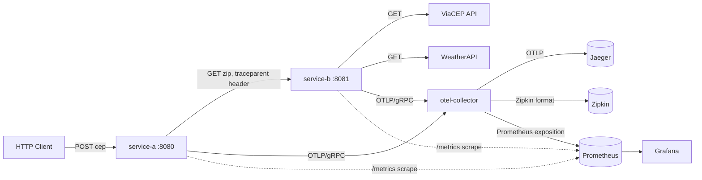
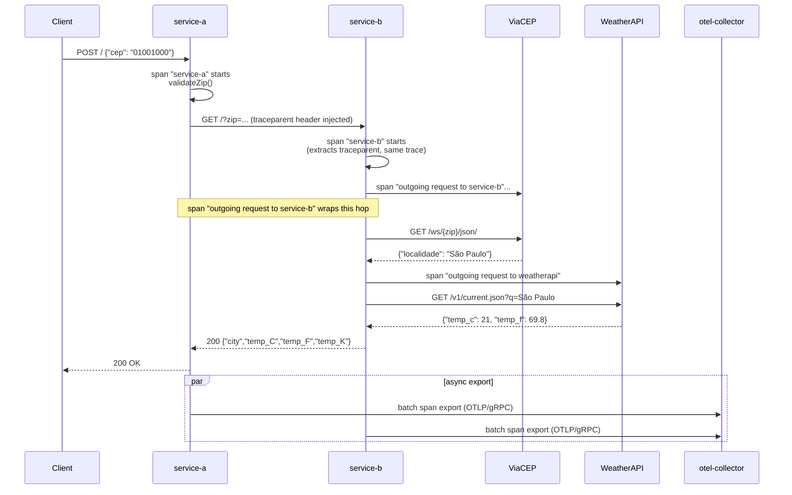

# End-to-End Distributed Observability Pipeline

Two Go microservices instrumented with OpenTelemetry, exporting distributed
traces to both Jaeger and Zipkin (via an OTel Collector) and metrics to
Prometheus/Grafana — built around a small "ZIP code → weather" use case to
have something concrete to trace.

- **service-a**: receives a ZIP code (Brazilian CEP) via POST, validates its
  shape, forwards it to service-b.
- **service-b**: resolves the ZIP code to a city (ViaCEP) and fetches current
  weather for that city (WeatherAPI), returning temperature in Celsius,
  Fahrenheit and Kelvin.
- Every hop (service-a → service-b → ViaCEP/WeatherAPI) is wrapped in an
  OpenTelemetry span, propagated across the HTTP boundary via W3C
  `traceparent` headers, so a single request produces one connected trace
  from edge to external API calls.

## Architecture

### Component overview



The collector fans each trace out to **two** backends simultaneously
(Jaeger via OTLP, Zipkin via its native format) — see "Tradeoff: dual trace
backends" below for why that's in the pipeline.

### Request sequence (single connected trace across 2 services + 2 external APIs)



A real captured trace for this flow (via `GET /api/traces` on Jaeger,
`docker compose up`, single request, no load):

| Span                              | Duration | Parent                  |
|------------------------------------|---------:|---------------------------|
| `service-a` (root)                 | 394.3 ms | —                          |
| `outgoing request to service-b`    | 386.8 ms | `service-a`                |
| `service-b`                        | 369.1 ms | `outgoing request to service-b` |
| `outgoing request to weatherapi`   |  83.6 ms | `service-b`                |

Reading this bottom-up: the WeatherAPI call is 83.6ms of the 369.1ms
`service-b` span — the rest is the (uninstrumented) ViaCEP call plus JSON
parsing. This kind of breakdown, for free, from three lines of SDK code per
hop, is the actual value proposition of the pipeline — it's what let me find
and fix the bug below.

## A real bug this instrumentation caught

While validating this pipeline, `getTempFromLocal` in service-a was
starting its outgoing-call span from `context.Background()` instead of
from the request's context — so the "outgoing request to service-b" span
was its own disconnected root trace, never linked to the parent `service-a`
span or to `service-b`'s own span. The three spans existed, but the trace
view showed three unrelated single-span traces instead of one connected
call chain. Fixed in `cmd/service-a/main.go` by threading `ctx` through
`getTempFromLocal` and using `http.NewRequestWithContext` so the propagated
`traceparent` header and the local span's parent agree. This is the kind of
bug that's invisible in logs and only shows up as "why does my trace have
gaps" in the tracing UI — which is exactly why the instrumentation exists.

## Configuration

```sh
docker compose up -d --build
```

Starts: `service-a` (`:8080`), `service-b` (`:8081`), `otel-collector`,
`jaeger-all-in-one` (UI on `:16686`), `zipkin` (`:9411`), `prometheus`
(`:9090`), `grafana` (`:3001`, admin/admin).

Send a request (needs a free [WeatherAPI](https://www.weatherapi.com/) key):

```sh
curl --request POST --url http://localhost:8080/ \
  --header 'api_key: <YOUR_WEATHER_API_KEY>' \
  --header 'content-type: application/json' \
  --data '{"cep": "<8-digit CEP>"}'
```

`zip.http` has ready-to-run requests for the VS Code REST Client extension;
fill in your own `api_key` (never commit a real key — see note below).

> **Security note:** an earlier version of `zip.http` in this repo's history
> had a live WeatherAPI key committed in plaintext. It has been removed from
> the current file content and should be treated as compromised — if it's
> yours, rotate it at weatherapi.com. Git history still contains it until
> the history itself is rewritten/force-pushed, which is a separate,
> deliberate action.

## Testing

```sh
go test ./...
```

`cmd/service-a` has unit tests for `validateZip` (table-driven, no network)
and benchmarks for pure OpenTelemetry SDK overhead (see below, also no
network — no dependency on Jaeger/Zipkin/collector being up).

## Benchmarks and Tradeoff Analysis

This pipeline's bottleneck in production is the two external, rate-limited,
free-tier APIs (ViaCEP, WeatherAPI) it calls — not the Go services or the
tracing SDK. So instead of a throughput number that would really be
measuring ViaCEP's rate limiter, the benchmark that's actually informative
here is: **how much overhead does the OpenTelemetry instrumentation itself
add per request**, independent of network calls.

```sh
go test ./cmd/service-a/... -run=^$ -bench=. -benchtime=3s -benchmem
```

Measured locally (Apple M1), using an in-memory exporter so no network or
collector is involved — this isolates pure SDK cost:

| Benchmark                              | ns/op | B/op | allocs/op |
|------------------------------------------|------:|-----:|----------:|
| `BenchmarkSpanOverhead` (always sampled)  | ~1,192 | 3,316 | 5 |
| `BenchmarkSpanOverhead_NoSampling`        | ~147   | 128   | 2 |

A sampled-and-recorded span costs ~1.2µs of CPU and ~3.3KB of allocation;
a span dropped by the sampler costs ~150ns and 128B — about 8x cheaper.
For context, the real captured trace above shows network hops costing
80-400ms each, so **the instrumentation overhead here is 3-5 orders of
magnitude smaller than the network calls it's measuring** — tracing is
effectively free relative to what it's observing, for this workload.

### Tradeoff: sampling strategy

The code uses `sdktrace.AlwaysSample()` — every request is traced, no
sampling. That's the right choice for a demo/low-traffic service (you want
100% trace coverage to debug it), but at real production volume it has a
cost:

| Strategy | Pros | Cons |
|---|---|---|
| `AlwaysSample` (used here) | Never misses a trace; simplest to reason about | ~1.2µs + 3.3KB per request-overhead; collector/backend storage grows linearly with traffic |
| `TraceIDRatioBased(0.1)` or similar | Overhead drops close to the `NeverSample` number (~150ns) for the 90% of requests not sampled; backend storage shrinks ~10x | Misses most individual requests — need tail-based sampling or error-biased sampling to still catch failures |
| Parent-based (respect upstream decision) | Keeps a trace connected/consistent across services instead of each service independently deciding | Requires the root service to make a sane sampling call; a bad decision there propagates everywhere |

At the traffic level two demo microservices see, `AlwaysSample` is correct.
The switch to ratio-based sampling is a one-line change
(`sdktrace.WithSampler(sdktrace.TraceIDRatioBased(0.1))` in `initProvider`)
the moment this ships to a path with real request volume — the benchmark
above is what motivates when that line gets changed.

### Tradeoff: dual trace backends (Jaeger via OTLP + Zipkin) from one collector

`.docker/otel-collector-config.yaml` fans the same trace data out to both
Jaeger (OTLP) and Zipkin simultaneously:

```yaml
exporters:
  debug:
  zipkin:
    endpoint: "http://zipkin:9411/api/v2/spans"
  otlp:
    endpoint: jaeger-all-in-one:4317
service:
  pipelines:
    traces:
      receivers: [otlp, zipkin]
      processors: [batch]
      exporters: [debug, otlp, zipkin]
```

| Approach | Pros | Cons |
|---|---|---|
| Single backend (e.g. Jaeger only) | Simpler ops, one UI, one storage backend to run/scale | Locked into that backend's query/retention model; migrating later means re-pointing every service |
| Dual backend via collector (used here) | The collector is the only thing that knows about Jaeger/Zipkin — services just emit OTLP; swapping/adding a backend is a collector-config change, zero code change | Collector does more work per span (batch, fan-out, two export paths); two UIs/datastores to operate |

Keeping services OTLP-only and doing backend fan-out in the collector is
the correct default: it means this repo could point traces at a different
backend (Honeycomb, Tempo, Datadog) by editing one YAML file, never
touching `cmd/service-a` or `cmd/service-b`.

### Tradeoff: synchronous vs batched span export

Both services use `sdktrace.NewBatchSpanProcessor` (async, batched export to
the collector) rather than a `SimpleSpanProcessor` (synchronous, exports
immediately on every `span.End()`):

| Approach | Pros | Cons |
|---|---|---|
| `SimpleSpanProcessor` | Span is exported before the request handler returns — no risk of losing it on crash; simplest failure mode | Every request pays the full export latency (network round-trip to the collector) inline — turns a fast in-process span into a slow one |
| `BatchSpanProcessor` (used here) | Export happens off the request's critical path, batched; request latency is unaffected by collector latency | Spans sit in an in-memory buffer until flushed — a crash between span-end and flush loses that span; added complexity of a background goroutine |

For a pipeline whose whole point is not adding meaningful latency to the
request path (see the benchmark above), batched async export is the only
sane choice — a synchronous exporter would mean every request's latency
includes however long the OTel collector takes to accept the span.

## Project layout

```
cmd/service-a/        input validation + orchestration, exposes :8080
cmd/service-b/        ZIP -> city (ViaCEP) -> weather (WeatherAPI), exposes :8081
.docker/               otel-collector + Prometheus scrape config
docker-compose.yaml    full stack: both services + collector + Jaeger + Zipkin + Prometheus + Grafana
```
